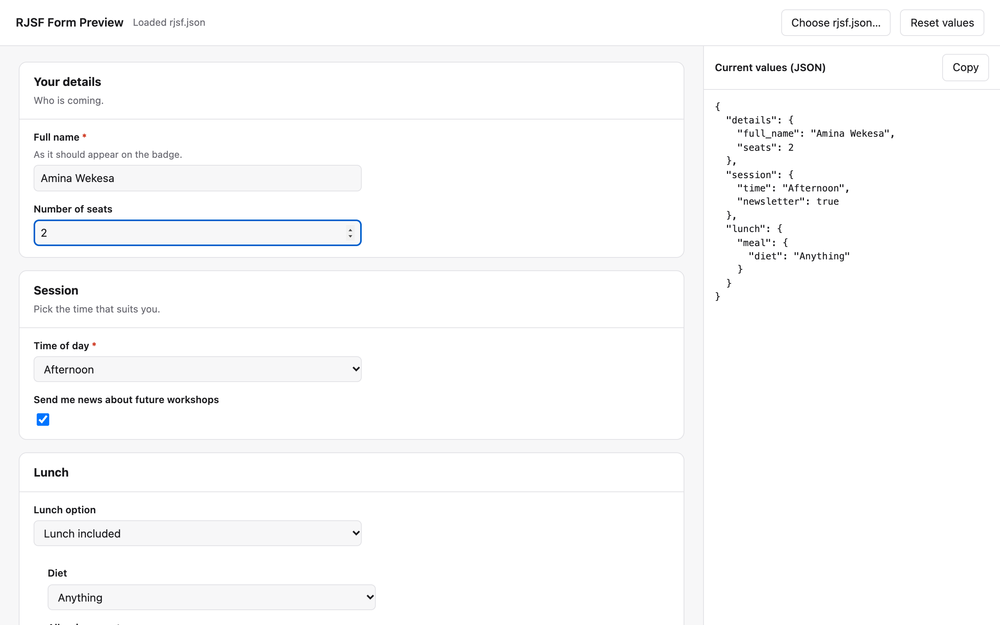

# RJSF Form Preview

Open an `rjsf.json` form definition and see the form it produces, live in your browser. Nothing is uploaded: the
file is read inside the page.

**[Open the tool](https://inka-labs.github.io/rjsf-form-preview/)** · **[See how it works](https://inka-labs.github.io/form-preview/)**

## What it does

- Reads any react-jsonschema-form style schema, including `$defs`, `$ref`, `oneOf`/`anyOf` variants and `uiSchema`.
- Draws one section per top-level property, with the field types, defaults, required marks and descriptions.
- Shows the current values as JSON beside the form, with **Copy** and **Reset values**.

## Use it offline

The whole tool is one file. Save [`index.html`](index.html) and open it from your computer.

## Licence

[Apache License 2.0](LICENSE). © 2026 Inka Labs.
